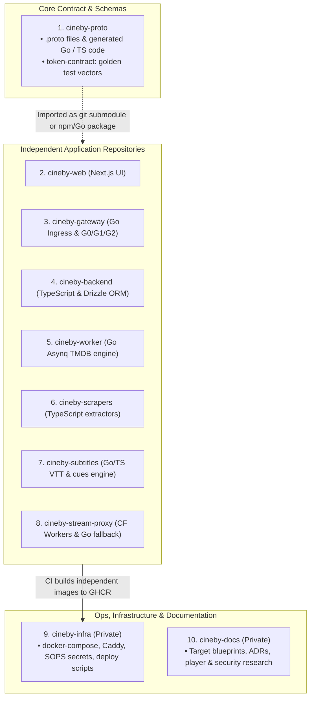
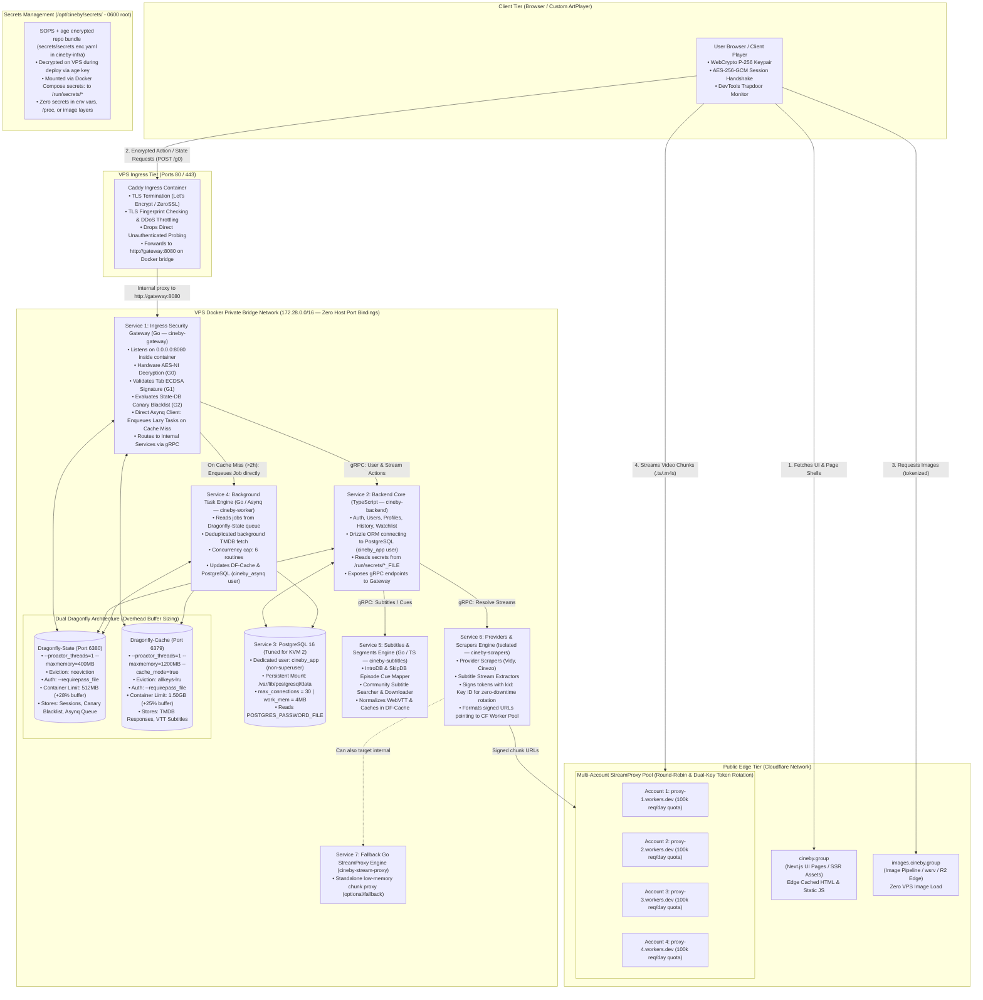

# Cineby Master Technical Architecture & Complete Migration Specification
### Target Environment: KVM 2 VPS (2 vCPUs, 8 GB RAM) + Multi-Account Cloudflare Edge (`*.workers.dev`)

---

## 0. Multi-Repository (Polyrepo) Ecosystem Architecture

The Cineby platform is organized as a **strict Polyrepo architecture**. Each service, client, proxy, and contract has its own **dedicated, standalone GitHub repository** with its own Git commit history, isolated CI/CD pipeline, independent semantic versioning, and scoped developer permissions.



### Detailed Repository Breakdown:

#### 1. `cineby-proto` (Shared Contract & Golden Vectors)
* **Purpose**: Single source of truth for all cross-service communication and cryptographic contracts.
* **Contents**:
  - `gateway.proto`, `scrapers.proto`, `subtitles.proto`, `backend.proto`.
  - Generated code: `gen/go/` (Go packages) and `gen/ts/` (npm package / TypeScript types).
  - `token-contract/`: Token format specification and cross-language golden test vectors ensuring tokens signed in TypeScript (`cineby-scrapers`) deserialize identically in Go (`cineby-gateway`) and Cloudflare Workers (`cineby-stream-proxy`).
* **Distribution**: Consumed by other repos as a Git submodule, private npm package, or Go module.

#### 2. `cineby-web` (Frontend Presentation Layer)
* **Purpose**: Next.js (Pages Router / React 19 / Tailwind CSS) user interface.
* **Scope**: UI components, pages, player integration (ArtPlayer), client-side WebCrypto `P-256` key generation, and AES-256-GCM `POST /g0` envelope encryption.
* **Deployment**: Built and edge-cached on Cloudflare Pages or standalone Docker container.

#### 3. `cineby-gateway` (Go Ingress & Security Engine)
* **Purpose**: Frontline defense and routing layer listening on internal `0.0.0.0:8080`.
* **Scope**: Hardware AES-NI G0 payload decryption, G1 ECDSA signature validation, G2 Canary blacklist evaluation via `dragonfly-state`, direct Asynq task enqueuing on cache miss, and gRPC routing.
* **CI/CD**: Compiles Go binary with `CGO_ENABLED=0` and pushes `ghcr.io/cineby/gateway:${COMMIT_SHA}`.

#### 4. `cineby-backend` (TypeScript Backend Core)
* **Purpose**: Central user domain and transactional business logic.
* **Scope**: Authentication (OAuth, sessions), user profiles, watch history progress, watchlist, and user settings. Manages PostgreSQL tables via **Drizzle ORM**.
* **CI/CD**: Runs TypeScript typecheck, tests, and pushes `ghcr.io/cineby/backend:${COMMIT_SHA}`.

#### 5. `cineby-worker` (Go Asynq Background Engine)
* **Purpose**: Asynchronous task processor.
* **Scope**: Pulls `tmdb:refresh` tasks from `dragonfly-state`, executes deduplicated TMDB fetches, and updates PostgreSQL and `dragonfly-cache` silently without blocking user requests.
* **CI/CD**: Compiles Go binary and pushes `ghcr.io/cineby/worker:${COMMIT_SHA}`.

#### 6. `cineby-scrapers` (Providers & Scrapers Engine)
* **Purpose**: Autonomous content extraction and stream resolution.
* **Scope**: Scraper modules (Vidy, Cinezo, etc.), embedded subtitle track extraction, multi-account Cloudflare pool URL formatting, and manifest signing with Key ID (`kid: "v2"`).
* **CI/CD**: Pushes `ghcr.io/cineby/scrapers:${COMMIT_SHA}`.

#### 7. `cineby-subtitles` (Subtitles & Segments Engine)
* **Purpose**: Media segment cues and multilingual subtitles service.
* **Scope**: IntroDB & SkipDB integration, community subtitle provider search/download, encoding normalization, and WebVTT conversion with 7-day Dragonfly cache.
* **CI/CD**: Pushes `ghcr.io/cineby/subtitles:${COMMIT_SHA}`.

#### 8. `cineby-stream-proxy` (Dual Streaming Proxies)
* **Purpose**: High-throughput video chunk streaming.
* **Scope**:
  - `worker/`: Cloudflare Worker code deployed across 4 separate free Cloudflare accounts (`*.workers.dev`) providing 400,000 requests/day.
  - `go-proxy/`: Standalone Go streaming chunk proxy binary used as a local fallback.
* **CI/CD**: Automated Wrangler deployments for Workers; Docker build for the Go fallback proxy (`ghcr.io/cineby/stream-proxy-go:${COMMIT_SHA}`).

#### 9. `cineby-infra` (Private: Infrastructure, Deployment & Secrets)
* **Purpose**: Server orchestration, networking, secrets, and runbooks.
* **Scope**:
  - `compose/`: `docker-compose.yml` with pinned image commit SHAs.
  - `caddy/Caddyfile`: Ingress TLS termination and reverse proxy configuration.
  - `postgres/`: `postgresql.conf` (tuned for KVM 2) and initialization SQL scripts.
  - `secrets/`: Encrypted master secrets file (`secrets.enc.yaml`) managed via **SOPS + age**.
  - `scripts/`: Zero-build deployment script (`deploy.sh`), database backups (`backup.sh`), and restore scripts (`restore.sh`).
* **Access**: Restricted strictly to server administrators and the dedicated VPS `deployer` SSH key.

#### 10. `cineby-docs` (Private: Architecture, ADRs & Research)
* **Purpose**: Permanent documentation, architectural history, and security research repository.
* **Scope**:
  - `architecture/`: Target blueprints, sequence diagrams, and migration plans.
  - `adr/`: Architecture Decision Records (e.g., `0001-multi-account-stream-pool.md`, `0002-dual-dragonfly-setup.md`).
  - `research/`: DevTools detection techniques, client cryptography, and scraper reverse engineering.

---

## 0.5. Local Developer Workspace & Directory Layout

To develop, test, and run the entire polyrepo ecosystem locally with maximum ergonomics, all repositories are cloned into a single root development workspace folder (e.g., `D:\ProjectsDesk\cineby-workspace\` or `~/code/cineby/`).

This layout enables **instant cross-repo testing**, shared editor workspaces (VS Code / Cursor / Zed), unified Go multi-module resolution (`go.work`), and Bun workspace linking without having to push to Git or pull remote Docker images during day-to-day coding.

### Recommended Local Workspace Folder Tree

```text
D:\ProjectsDesk\cineby-workspace/
│
├── cineby-proto/                   # Contract & Schemas Repo
│   ├── proto/                      # Raw .proto schema files
│   │   ├── gateway.proto
│   │   ├── backend.proto
│   │   └── scrapers.proto
│   ├── gen/                        # Generated bindings (committed or generated on pre-commit)
│   │   ├── go/                     # Go struct & gRPC client/server packages
│   │   └── ts/                     # TypeScript types and protobuf-ts bindings
│   ├── token-contract/             # Shared cryptographic token format specs & golden test vectors
│   └── package.json                # Allows local npm linking (bun link)
│
├── cineby-web/                     # Next.js Frontend (UI Only)
│   ├── pages/                      # Pages Router routes (today's watch, browse, search)
│   ├── components/                 # React UI, ArtPlayer, subtitles popover, hero cards
│   ├── lib/                        # Client-side WebCrypto P-256 & G0 envelope encryption
│   ├── public/                     # Static icons, favicons, fonts
│   ├── package.json
│   └── .env.local                  # Points API calls to http://localhost:8080 (or Caddy dev port)
│
├── cineby-gateway/                 # Go Ingress Gateway & Security Service
│   ├── cmd/gateway/main.go         # Service entrypoint
│   ├── internal/
│   │   ├── crypto/                 # AES-NI G0 decrypt & WebCrypto ECDSA verify
│   │   ├── canary/                 # Dragonfly-State blacklist lookups
│   │   ├── asynq/                  # Direct Asynq client for lazy task enqueuing
│   │   └── router/                 # Internal gRPC routing table
│   ├── go.mod
│   └── Dockerfile
│
├── cineby-backend/                 # TypeScript Backend Core
│   ├── src/
│   │   ├── index.ts                # gRPC server entrypoint
│   │   ├── auth/                   # Google OAuth & session management
│   │   ├── db/                     # Drizzle schema definitions & PostgreSQL connection pool
│   │   ├── domain/                 # User profiles, watch history progress, watchlist
│   │   └── subtitles/              # Built-in subtitles module (IntroDB/SkipDB cues + VTT normalizer)
│   ├── migrations/                 # Drizzle SQL migration files
│   ├── drizzle.config.ts
│   ├── package.json
│   └── Dockerfile
│
├── cineby-worker/                  # Go Background Task Worker (Asynq)
│   ├── cmd/worker/main.go          # Worker entrypoint
│   ├── internal/
│   │   ├── tasks/                  # Task handlers (tmdb:refresh deduplicated jobs)
│   │   ├── tmdb/                   # TMDB REST client with rate-limiting
│   │   └── store/                  # Dual write: PostgreSQL + Dragonfly-Cache
│   ├── go.mod
│   └── Dockerfile
│
├── cineby-scrapers/                # TypeScript Providers & Scrapers
│   ├── src/
│   │   ├── index.ts                # gRPC server entrypoint
│   │   ├── providers/              # Individual provider modules (Vidy, Cinezo, etc.)
│   │   ├── subtitles/              # Embedded provider subtitle & audio track extractors
│   │   └── signer/                 # Dual-key manifest token signer (kid: v2)
│   ├── package.json
│   └── Dockerfile
│
├── cineby-stream-proxy/            # Streaming Proxies
│   ├── worker/                     # Cloudflare Worker code (today's workers/stream-proxy)
│   │   ├── worker.ts
│   │   └── wrangler.jsonc
│   └── go-proxy/                   # Standalone Go streaming chunk proxy binary (fallback)
│       ├── main.go
│       └── go.mod
│
├── cineby-infra/                   # Private Ops & Orchestration Repo
│   ├── compose/
│   │   ├── docker-compose.dev.yml  # Local developer stack (DB, Dragonfly, Gateway, etc.)
│   │   └── docker-compose.prod.yml # Production VPS stack (pulls pre-built GHCR images)
│   ├── caddy/
│   │   └── Caddyfile               # Ingress reverse proxy rules
│   ├── postgres/
│   │   ├── postgresql.conf         # PostgreSQL configuration
│   │   └── init/                   # DB init SQL scripts & role creation
│   ├── secrets/
│   │   ├── secrets.enc.yaml        # SOPS + age encrypted master secrets
│   │   └── .dev.env                # Local development plain secrets (gitignored)
│   └── scripts/
│       ├── dev.sh                  # One-command developer bootstrap script
│       └── deploy.sh               # Remote VPS deploy script
│
├── cineby-docs/                    # Private Documentation & Decisions Repo
│   ├── architecture/               # vps_target_architecture_blueprint.md
│   ├── adr/                        # Architecture Decision Records (0001, 0002...)
│   └── research/                   # Anti-tamper & reverse-engineering notes
│
├── go.work                         # Local Go Workspace (Combines all local Go repos)
│   # use ./cineby-gateway
│   # use ./cineby-worker
│   # use ./cineby-stream-proxy/go-proxy
│   # use ./cineby-proto/gen/go
│
└── package.json                    # Local Bun Workspace Root (Optional: links TS repos locally)
```

---

### Local Developer Workflow & Ergonomics

1. **Unified Go Development via `go.work`**:
   The workspace root `go.work` file references `./cineby-gateway`, `./cineby-worker`, and `./cineby-proto/gen/go`. Any change you make in `cineby-proto` is immediately available in `cineby-gateway` without committing, publishing, or bumping module versions.

2. **Unified TypeScript Development via `bun link`**:
   `cineby-proto` and shared packages are linked locally into `cineby-web`, `cineby-backend`, and `cineby-scrapers` using `bun link`:
   ```bash
   cd cineby-proto && bun link
   cd ../cineby-backend && bun link @cineby/proto
   ```

3. **Subtitles Starting as a Backend Module**:
   As planned, subtitles start inside `cineby-backend/src/subtitles/` (IntroDB/SkipDB cues + community subtitle parser) to keep container count minimal on KVM 2. If future performance metrics show high CPU utilization from VTT parsing, the module is structured cleanly to be extracted into its own standalone microservice repository (`cineby-subtitles`) without rewriting business logic.

4. **One-Command Local Environment (`docker-compose.dev.yml`)**:
   In `cineby-infra/compose/docker-compose.dev.yml`, you spin up the backing services locally with one command:
   ```bash
   cd cineby-infra && docker compose -f compose/docker-compose.dev.yml up -d
   ```
   This boots:
   - `postgres` on port `5432`
   - `dragonfly-state` on port `6380`
   - `dragonfly-cache` on port `6379`
   You can then run `cineby-web`, `cineby-backend`, or `cineby-gateway` in watch mode (`bun run dev` or `air`) directly on your host machine for instant hot-reload.

---

## 1. Complete System Topology & End-to-End Traffic Flow



---

## 2. Microservices: Deep Technical Specifications (All 7 Services)

### Service 1: Ingress Security Gateway (Go — `cineby-gateway`)
* **Language & Runtime**: Pure Go (compiled binary with `CGO_ENABLED=0`, minimal Alpine/scratch container).
* **Network Binding**: Listens on **`0.0.0.0:8080`** inside the container. Accessible exclusively over the internal Docker network (`reverse_proxy gateway:8080` from Caddy). Host port 8080 is not mapped.
* **Security & Verification Logic**:
  1. **G0 De-obfuscation**: Catches incoming `POST /g0` requests with schema `{"d": "<ciphertext_hex>", "n": "<iv_hex>"}`. Retrieves the AES-256 session key associated with the client's `x-cb-sid` from `dragonfly-state`. Decrypts payload using hardware AES-NI instructions (`crypto/cipher` AES-GCM) in <0.3ms.
  2. **G1 Tab-Bound Verification**: Validates ECDSA P-256 signatures (`ts` + `nonce` signed by client's WebCrypto private key). Rejects replayed, tampered, or forwarded payloads immediately.
  3. **G2 Canary Evaluation**: Checks if `x-cb-sid` exists in the `dragonfly-state` Canary blacklist (triggered if client opened DevTools and fetched a decoy source map). Immediately drops blacklisted sessions with HTTP 403.
  4. **Direct Asynq Client**: When handling metadata requests, if the item in `dragonfly-cache` is older than 2 hours or missing, the Gateway serves stale/cached data to the user immediately and enqueues the `tmdb:refresh` task directly into `dragonfly-state` using the Go `asynq.Client`.
  5. **gRPC Multiplexing**: Unmarshals plaintext JSON into internal Protobuf messages defined in `cineby-proto` and routes to the target service over gRPC.

### Service 2: Backend Core (TypeScript — `cineby-backend`)
* **Language & Runtime**: TypeScript on Node.js 22 LTS or Bun.
* **Responsibilities**:
  1. **Authentication & Session Management**: Google OAuth callbacks, email/password signup (`bcryptjs`), session token minting.
  2. **User Domain Operations**: Multi-profile support, watchlists, watch history progress (timestamp bookmarks for resume playback), and client settings.
  3. **Database Access via Drizzle ORM**: Direct connection to the PostgreSQL container using dedicated non-superuser role `cineby_app`. Consumes schemas defined in its own codebase or imported from `cineby-proto`.
  4. **Secrets Access**: Reads database credentials from `/run/secrets/db_password_app_FILE` mounted via Docker Compose secrets.
  5. **gRPC Server**: Implements `BackendService` Protobuf contracts, receiving typed calls from `cineby-gateway`.

### Service 3: Persistent Database (PostgreSQL 16 — `cineby-infra/postgres`)
* **Image**: `postgres:16-alpine`.
* **Host Binding**: Internal Docker bridge only (`172.28.0.x`). Host port mapping (`5432:5432`) is disabled.
* **Storage Mount**: Persistent Docker volume bound to NVMe storage (`/var/lib/postgresql/data`).
* **Tuned Configuration for KVM 2 (2 vCPUs, 8 GB RAM)**:
  - `max_connections = 30` (managed via Drizzle connection pooler / node-postgres pool).
  - `shared_buffers = 512MB` (allocated once at startup).
  - `work_mem = 4MB` (maximum 30 * 4MB = 120MB transient query memory).
  - `maintenance_work_mem = 64MB`.
  - `effective_cache_size = 1024MB`.
  - Total worst-case footprint capped at **~700MB–800MB**.
* **Least-Privilege Roles**:
  - `cineby_app`: Non-superuser for Backend Core (SELECT, INSERT, UPDATE, DELETE on application tables).
  - `cineby_asynq`: Restricted role for Asynq worker (SELECT, INSERT, UPDATE on TMDB cache tables only).
  - `postgres` superuser disabled for application connections; reads `POSTGRES_PASSWORD_FILE=/run/secrets/db_password_root`.

### Service 4: Lazy Background Worker Engine (Go + Asynq — `cineby-worker`)
* **Language & Runtime**: Compiled Go binary using `hibiken/asynq`.
* **Queue Backend**: Connects to `dragonfly-state` (port 6380, auth via `/run/secrets/df_state_pass`).
* **Responsibilities**:
  1. **Lazy TMDB Metadata Refresh**: When a user visits a title whose cache age exceeds 2 hours, Asynq enqueues a background update job.
  2. **Job Deduplication**: Uses Asynq's unique task keys (`task:tmdb:update:{media_type}:{id}`) with a 30-minute lock window. If 500 users click the same trending movie simultaneously, only 1 TMDB fetch executes.
  3. **Strict Concurrency Cap**: Configured with `Concurrency: 6`. Will never spawn more than 6 simultaneous worker routines, keeping VPS CPU utilization low and respecting TMDB API limits.
  4. **Persistence Sync**: Writes refreshed TMDB payloads into PostgreSQL and `dragonfly-cache` simultaneously.

### Service 5: Subtitles & Segments Engine (`cineby-subtitles`)
* **Language & Runtime**: Go or TypeScript microservice (starts as a backend module in `cineby-backend/src/subtitles/`, extracted into standalone microservice if metrics demand it).
* **Isolation Rationale**: Subtitle format parsing (SRT, WebVTT, ASS), encoding normalization (UTF-8, Latin-1), and timestamp cue synchronization are CPU and memory-intensive operations. Isolating this service protects the Backend Core from latency spikes.
* **Responsibilities**:
  1. **IntroDB & SkipDB Integration**: Fetches and caches intro/outro/recap start and end cues per episode ID.
  2. **Community Subtitles Pipeline**: Integrates with external subtitle providers (OpenSubtitles, community subtitle indexers) to retrieve multilingual subtitle tracks on demand when a title is missing native tracks.
  3. **Format Normalization**: Converts raw subtitle payloads into standardized, sanitized WebVTT format ready for ArtPlayer.
  4. **Caching**: Caches normalized VTT tracks in `dragonfly-cache` with a 7-day TTL.

### Service 6: Providers & Scrapers Engine (Isolated — `cineby-scrapers`)
* **Language & Runtime**: TypeScript / Node.js.
* **Responsibilities**:
  1. **Autonomous Provider Scrapers**: Houses scraper implementations for active providers (Vidy, Cinezo, and future additions).
  2. **Inbuilt Subtitle Extraction**: Automatically extracts embedded subtitle and alternative audio stream URLs from provider stream manifests.
  3. **Multi-Account URL Pool Rotation**: Assigns chunk requests to one of the 4 Cloudflare StreamProxy accounts (`proxy-1.workers.dev`, `proxy-2.workers.dev`, etc.) using round-robin distribution to maximize the combined 400,000 free request daily quota.
  4. **Dual-Key Manifest Signing**: Signs media manifests with a Key ID (`kid: "v2"`) using `STREAM_KEY_CURRENT`. Conforms to specifications verified in `cineby-proto` (`token-contract`).

### Service 7: Standalone StreamProxy Engine (Go Fallback — `cineby-stream-proxy`)
* **Language & Runtime**: Compiled Go streaming binary included in Docker stack.
* **Role**: Ephemeral buffer chunk proxy with upstream header spoofing (`Referer`, `Origin`) and JIT token verification. Acts as a standalone fallback proxy if Cloudflare Workers experience upstream blocking or if a private proxy route is required.

---

## 3. Communication Protocol: Internal gRPC (Protobuf — `cineby-proto`)

All inter-service communication inside the Docker network uses gRPC over HTTP/2 defined centrally in `cineby-proto`.

### A. Gateway & Router Contract (`gateway.proto`)
```protobuf
syntax = "proto3";
package cineby.gateway;

service GatewayService {
  rpc RouteAction (ClientRequestEnvelope) returns (ClientResponseEnvelope);
}

message ClientRequestEnvelope {
  string session_id = 1;
  string action = 2;          // e.g., "stream.resolve", "history.sync", "movie.get"
  bytes decrypted_payload = 3; // Raw JSON bytes decoded from G0 AES-GCM
  int64 timestamp = 4;
}

message ClientResponseEnvelope {
  int32 status_code = 1;
  bytes response_payload = 2; // Response data to be encrypted back to client
  string error_message = 3;
}
```

### B. Streaming & Scrapers Contract (`scrapers.proto`)
```protobuf
syntax = "proto3";
package cineby.scrapers;

service ScraperService {
  rpc ResolveStream (StreamResolveRequest) returns (StreamResolveResponse);
}

message StreamResolveRequest {
  string media_type = 1;      // "movie" or "tv"
  int64 tmdb_id = 2;
  int32 season = 3;
  int32 episode = 4;
  string preferred_provider = 5;
  string session_id = 6;
}

message StreamTrack {
  string label = 1;
  string url = 2;
  string mime_type = 3;
}

message StreamResolveResponse {
  bool success = 1;
  string manifest_url = 2;     // Signed URL pointing to CF Worker Pool
  string provider_used = 3;
  repeated StreamTrack subtitles = 4;
  int64 intro_start = 5;
  int64 intro_end = 6;
}
```

---

## 4. Dual Dragonfly Architecture (Overhead Buffer & Eviction Separation)

Dragonfly requires dynamic memory for connections, proactor thread rings, and internal sharding metadata beyond the raw data stored in `--maxmemory`. Setting Docker's `mem_limit` equal to `--maxmemory` triggers an OOM kill from Docker when the keyspace fills up.

We configure two isolated containers with explicit **+25% to +28% safety buffers**:

1. **`dragonfly-state` (Port 6380)**:
   - Config: `--proactor_threads=1 --maxmemory=400MB`
   - Eviction: `noeviction` (prevents dropping active logins or background jobs).
   - Container `mem_limit`: **512 MB** (+28% buffer).
   - Dedicated exclusively to:
     - Active session keys (`x-cb-sid`).
     - G2 Canary security blacklist.
     - **Asynq message queue Redis keys**.
2. **`dragonfly-cache` (Port 6379)**:
   - Config: `--proactor_threads=1 --maxmemory=1200MB --cache_mode=true`
   - Eviction: `allkeys-lru`.
   - Container `mem_limit`: **1.50 GB (1536 MB)** (+28% buffer).
   - Dedicated exclusively to:
     - TMDB metadata responses.
     - Normalized WebVTT subtitle caches.

*Note: Verified Dragonfly docs — the correct flag is **`--proactor_threads`**, not `--threads`.*

---

## 5. Secrets Management: SOPS + age & Docker Compose Files

### A. Principle: No Plain Environment Variables for Sensitive Data
Passing secrets via standard environment variables exposes them to `docker inspect`, process listings in `/proc/<pid>/environ`, and crash logs.

**Pattern**:
1. Every secret is stored as a single plaintext file in `/opt/cineby/secrets/`, owned by `root:root` with permissions `chmod 600`.
2. Mounted into containers using **Docker Compose `secrets:`** at `/run/secrets/<name>`.
3. Application code and service entrypoints read from `<NAME>_FILE` environment variables.

### B. Secret Catalog (Generated via `openssl rand -hex 32`)
* `/opt/cineby/secrets/db_password_app`: Password for `cineby_app` PostgreSQL role.
* `/opt/cineby/secrets/db_password_asynq`: Password for `cineby_asynq` PostgreSQL role.
* `/opt/cineby/secrets/df_state_password`: Authentication for `dragonfly-state` (`--requirepass`).
* `/opt/cineby/secrets/df_cache_password`: Authentication for `dragonfly-cache` (`--requirepass`).
* `/opt/cineby/secrets/stream_signing_key_current`: Active HMAC-SHA256 key for media manifests.
* `/opt/cineby/secrets/stream_signing_key_previous`: Previous HMAC-SHA256 key for seamless rotation.
* `/opt/cineby/secrets/gateway_master_key`: Master AES key for G0 initial handshake derivation.
* `/opt/cineby/secrets/tmdb_api_key`: TMDB Read Access Token.

### C. Version Control & Recovery: SOPS + age
1. Secrets are stored encrypted in the git repository as `secrets/secrets.enc.yaml` in `cineby-infra` using **Mozilla SOPS** and an **age** key pair.
2. The `age` private key is backed up off-server in a password manager and placed on the VPS at `/root/.config/sops/age/keys.txt` (`chmod 600`).
3. Deploy step executes:
   ```bash
   sops -d secrets/secrets.enc.yaml > /opt/cineby/secrets/unpacked.env
   # Map into individual /opt/cineby/secrets/* files with chmod 600
   ```
4. If the server or OS is lost, secrets are easily restored from git by supplying the age private key.

---

## 6. Cloudflare StreamProxy Pool: Zero-Downtime Key Rotation

Streaming bandwidth remains **100% offloaded to Cloudflare Workers**.
- 4 separate free Cloudflare accounts:
  1. `https://proxy-1.workers.dev` (100k requests/day)
  2. `https://proxy-2.workers.dev` (100k requests/day)
  3. `https://proxy-3.workers.dev` (100k requests/day)
  4. `https://proxy-4.workers.dev` (100k requests/day)
- Combined capacity: **400,000 requests/day**.
- **Rotation Procedure with Key ID (`kid`)**:
  1. Manifest tokens include a **Key ID (`kid: "v2"`)** in the payload.
  2. Cloudflare Workers store `STREAM_KEY_CURRENT` and `STREAM_KEY_PREVIOUS` via `wrangler secret put`.
  3. The Worker checks the token's `kid`:
     - If `kid === "v2"`, validates against `STREAM_KEY_CURRENT`.
     - If `kid === "v1"`, validates against `STREAM_KEY_PREVIOUS`.
  4. Deployment rotates keys without 403 playback interruptions for active users.

---

## 7. Strict Resource Budgets (KVM 2: 2 vCPUs, 8 GB RAM)

### A. Memory Allocation (Host Total: 8.0 GB)
*Container limits are hard-capped at **6.35 GB**, leaving **1.65 GB (20.6%) guaranteed host headroom** for the Debian Linux kernel, Docker daemon, page cache, and buffer space.*

| Service | Container Limit (`mem_limit`) | Internal Config / Buffer | Role / Justification |
|---|:---:|:---:|---|
| **Host OS, Docker & Buffers** | *Reserved (1.65 GB)* | — | Kernel TCP stack, page cache, disk I/O buffers |
| **Dragonfly-Cache** | 1.50 GB | `--maxmemory=1200MB` (+28% buffer) | TMDB metadata, WebVTT subtitle tracks |
| **PostgreSQL 16** | 1.00 GB | `shared_buffers=512MB`, 30 conn @ 4MB `work_mem` | User auth, profiles, history, Drizzle ORM |
| **TypeScript Backend Core** | 0.90 GB | Node.js / Bun runtime + Drizzle | Business logic & gRPC endpoints |
| **Dragonfly-State** | 0.50 GB | `--maxmemory=400MB` (+28% buffer) | Sessions, Canary blacklist, Asynq queue |
| **G0 Ingress Gateway (Go)** | 0.40 GB | Compiled Go binary, AES-NI | Hardware decrypt, tab signature check |
| **Providers & Scrapers** | 0.50 GB | Node.js runtime | Scraper execution & manifest signing |
| **Asynq Worker Engine (Go)** | 0.40 GB | Max 6 concurrent routines | Throttled background TMDB updates |
| **Subtitles & Segments** | 0.50 GB | Go / TS microservice | Cues & VTT normalization |
| **Caddy Ingress** | 0.40 GB | Native Go binary | SSL termination & reverse proxy |
| **Go StreamProxy (Fallback)** | 0.25 GB | Ephemeral buffer streaming | Standalone fallback chunk proxy |
| **Total Container Limits** | **6.35 GB** | — | **Leaves 1.65 GB (20.6%) free host headroom** |

---

### B. CPU Allocation (Host Total: 2.0 vCPUs)
*Proportional `cpu_shares` ensure background routines never starve user-facing requests during traffic bursts.*

| Service | Max CPU Quota (`cpus`) | CPU Shares (`cpu_shares`) | Priority Rationale |
|---|:---:|:---:|---|
| **Caddy Ingress** | 0.75 | 512 | Fast network proxying |
| **G0 Ingress Gateway (Go)** | 1.00 | 1024 (High) | Immediate G0 decryption & request routing |
| **TypeScript Backend Core** | 1.00 | 1024 (High) | User-facing queries & auth |
| **PostgreSQL 16** | 1.00 | 1024 (High) | Fast database queries |
| **Dragonfly-Cache** | 0.50 | 512 (Medium) | Proactor thread I/O, sub-millisecond |
| **Dragonfly-State** | 0.50 | 512 (Medium) | Proactor thread I/O, sub-millisecond |
| **Asynq Worker Engine (Go)** | 0.50 | 256 (Low/Background) | Throttled background updates |
| **Subtitles & Segments** | 0.50 | 256 (Low) | Non-critical path |
| **Providers & Scrapers** | 0.50 | 256 (Low) | Resolves only when user opens video player |

---

## 8. Hardened CI/CD Deployment Workflow (Zero VPS Build)

```
[ Developer Push to main in any cineby-* repository ]
          │
          ├── Pre-commit / GitHub Push Protection: Secret Scanning (Gitleaks)
          │
          ▼
[ GitHub Actions CI Runner (in that specific repo) ]
          ├── 1. Run typecheck, unit tests, and Gitleaks security scan
          ├── 2. Compile Go binaries (if Go repo) with CGO_ENABLED=0
          ├── 3. Build minimal Docker image tagged by commit SHA:
          │      • ghcr.io/cineby/<repo-name>:${COMMIT_SHA}
          ├── 4. Push image to GitHub Container Registry (GHCR)
          │
          ▼ (SSH via dedicated 'deployer' user with restricted sudo)
[ KVM 2 VPS Server (cineby-infra deploy.sh) ]
          ├── 1. Decrypt secrets using SOPS + age:
          │      sops -d secrets/secrets.enc.yaml -> /opt/cineby/secrets/* (chmod 600)
          ├── 2. Authenticate to GHCR using deploy token
          ├── 3. Update docker-compose.yml with new ${COMMIT_SHA}
          ├── 4. docker compose pull
          ├── 5. docker compose up -d --remove-orphans
          └── 6. docker image prune -f
```

### Security Hardening Measures:
1. **GitHub Secrets**: Contains ONLY the SSH private key for the dedicated `deployer` VPS user and the GHCR read-only pull token.
2. **Dedicated Deploy User**: `deployer` user on VPS has no login shell and `sudoers` privileges strictly limited to `docker compose`.
3. **Automated Audit**: `gitleaks` runs on every CI run; GitHub push protection blocks accidental commits containing keys or certificates.
